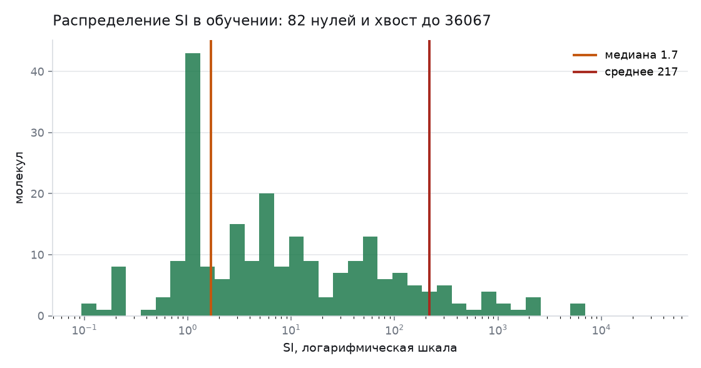
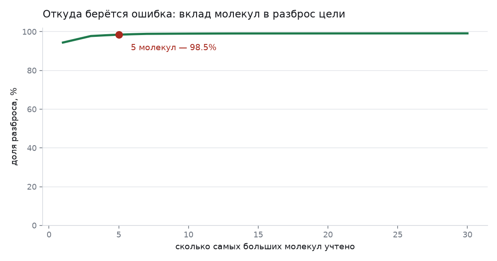
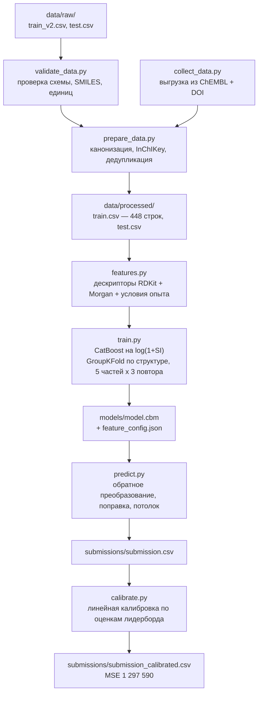
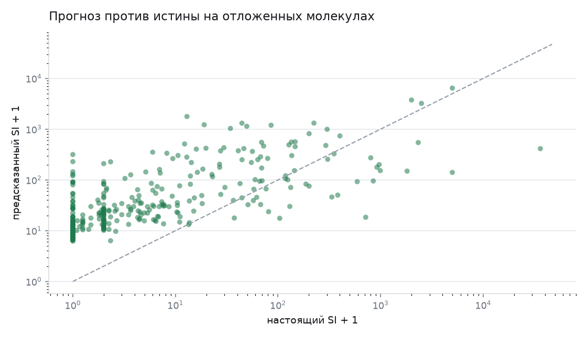
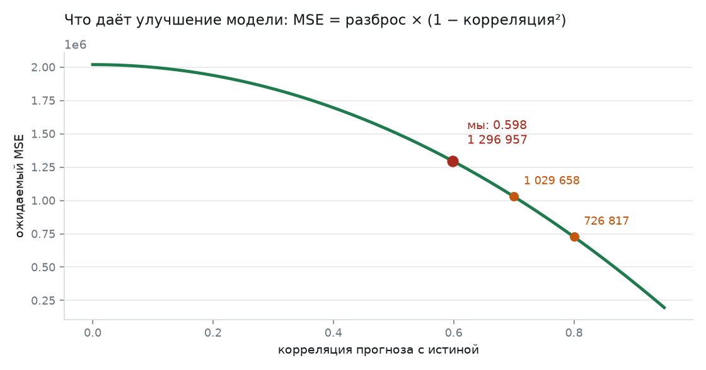
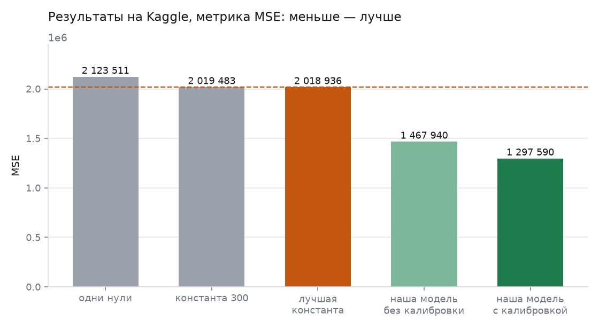

# Проект от А до Я: прогноз индекса селективности против вируса осповакцины

Кейс «Поиск лекарства», хакатон НИЯУ МИФИ, команда **MCGA**.

---

## Краткая сводка

**Что просят сделать.** Дана молекула в виде текстовой строки (SMILES). Нужно предсказать
число — индекс селективности SI против вируса осповакцины. Это регрессия: на вход строка,
на выход одно вещественное число.

**Что такое SI.** `SI = CC50 / IC50`. IC50 — концентрация, при которой вещество наполовину
давит вирус. CC50 — концентрация, при которой оно наполовину убивает сами клетки. Их отношение
показывает, насколько широк промежуток между «лечит» и «травит». SI = 1 — бесполезно,
SI = 100 — интересный кандидат.

**Данные.** 320 молекул с ответами у организаторов, 597 молекул без ответов для проверки.
Плюс 196 молекул, которые мы сами выгрузили из открытой базы ChEMBL со ссылками на статьи.

**Что мы построили.** Молекула → числа (дескрипторы RDKit + Morgan fingerprints + условия
опыта) → CatBoost, обученный на `log(1 + SI)` → обратное преобразование с поправкой на
среднее → линейная калибровка по публичным оценкам лидерборда.

**Главное открытие по данным.** 98,5 % всего разброса цели сидит в пяти молекулах с SI от
2325 до 36 067. Метрика соревнования — MSE, то есть средний квадрат ошибки. Значит почти весь
результат определяется тем, насколько мы угадали эти несколько гигантов, а не тем, как хорошо
мы работаем на основной массе.

**Где мы сейчас.**

| Что отправляли | MSE на Kaggle |
| --- | --- |
| одни нули | 2 123 511 |
| постоянное число 300 | 2 019 483 |
| наилучшее постоянное число (предел «модели без модели») | 2 018 937 |
| наша модель без калибровки | 1 467 940 |
| **наша модель после калибровки** | **1 297 590** |

Место: **23 из 50**. Корреляция нашего прогноза с настоящими ответами теста — **0,598**.

**Честность.** В файле `test.csv` организаторы по недосмотру оставили колонки CC50 и IC50,
из которых ответ получается прямым делением. Мы этим не пользуемся: правила это запрещают, и
защита идёт по коду. Команды в топ-5 со значениями 168–667 получили их не моделью — такой
результат при честном обучении на 320 молекулах недостижим.

---

## Оглавление

1. [Биология: что вообще меряем](#1-биология-что-вообще-меряем)
2. [Постановка задачи](#2-постановка-задачи)
3. [Данные и их проверка](#3-данные-и-их-проверка)
4. [Главная особенность цели](#4-главная-особенность-цели)
5. [Схема всего решения](#5-схема-всего-решения)
6. [Как молекула превращается в числа](#6-как-молекула-превращается-в-числа)
7. [Внешние данные из ChEMBL](#7-внешние-данные-из-chembl)
8. [Модель и обучение](#8-модель-и-обучение)
9. [Как мы проверяем качество](#9-как-мы-проверяем-качество)
10. [Калибровка по лидерборду](#10-калибровка-по-лидерборду)
11. [Результаты](#11-результаты)
12. [Что пробовали и отвергли](#12-что-пробовали-и-отвергли)
13. [Ограничения и честные оговорки](#13-ограничения-и-честные-оговорки)
14. [Как всё воспроизвести](#14-как-всё-воспроизвести)
15. [Карта файлов](#15-карта-файлов)

---

## 1. Биология: что вообще меряем

Вирус осповакцины (vaccinia virus, VACV) — это ортопоксвирус, ближайший родственник вирусов
натуральной оспы и оспы обезьян. Работать с самой оспой в лаборатории нельзя, поэтому
испытания противооспенных веществ ставят на VACV: он безопаснее и устроен почти так же.
Поэтому в постановке задачи и всплывает «обезьянья оспа» — это один и тот же класс мишеней.

Опыт выглядит так. Берут культуру клеток, заражают вирусом, добавляют вещество в разных
концентрациях и смотрят две вещи:

- **IC50** — при какой концентрации вирус подавлен наполовину. Чем меньше, тем вещество
  сильнее бьёт по вирусу.
- **CC50** — при какой концентрации погибает половина клеток без всякого вируса. Чем больше,
  тем вещество безопаснее.

Отношение и есть индекс селективности:

```
SI = CC50 / IC50
```

Смысл простой. Вещество, которое убивает вирус при 1 мкМ, а клетки травит только при 100 мкМ,
имеет SI = 100 — в сто раз больше запас. Вещество, которое и вирус, и клетки гасит при 10 мкМ,
имеет SI = 1 — это просто яд, который заодно попадает в вирус. Поэтому SI и есть первичный
фильтр при отборе кандидатов в лекарства.

---

## 2. Постановка задачи

Вход — SMILES-строка. Это текстовая запись структуры молекулы: `CCO` — этиловый спирт,
`CC(=O)Oc1ccccc1C(=O)O` — аспирин. Буквы — атомы, скобки — ветвления, цифры — замыкания колец.

Выход — одно число, прогноз SI.

Метрика — **MSE**, средний квадрат ошибки:

```
MSE = среднее( (прогноз − правда)² )
```

Чем меньше, тем лучше. Ключевое свойство квадрата: ошибка на 10 даёт вклад 100, а ошибка на
1000 — вклад миллион. Поэтому одна большая промашка весит столько же, сколько десять тысяч
мелких. Это полностью определяет стратегию, см. раздел 4.

Файл ответа — две колонки, `index` и `SI VACV`, 597 строк. Формат берётся из
`data/raw/sample_submit.csv` и проверяется кодом перед записью.

---

## 3. Данные и их проверка

Исходные файлы лежат в `data/raw/`:

| Файл | Строк | Что внутри |
| --- | --- | --- |
| `train_v2.csv` | 320 | SMILES, CC50_uM, IC50_uM_VACV, `SI VACV`, strain, Culture |
| `test.csv` | 597 | то же, но без целевой колонки |
| `sample_submit.csv` | 597 | образец ответа |

Проверку делает [`src/validate_data.py`](../src/validate_data.py), результат сохраняется в
`reports/data_audit.json`. Что она показала:

| Проверка | Результат |
| --- | --- |
| испорченные SMILES | 0 в обоих файлах |
| `SI VACV == CC50 / IC50` | выполняется для всех 320 строк |
| строк с нулевой целью | 83 |
| из них без измеренного IC50 | 81 |
| дубликаты структур в train | 8 |
| дубликаты структур в test | 27 |
| одинаковых структур в train и test | 29 |
| медиана SI | 1,84 |
| максимум SI | 36 067 |

Три вывода из этой таблицы, и все три важные.

**Нули — это не «селективности нет», а «не измерили».** Из 83 нулевых значений 81 приходится
на строки, где IC50 просто отсутствует. Организаторы поставили ноль как заглушку. Модель
вынуждена эту разметку воспроизводить, потому что метрика считается именно по ней, но
биологического смысла в этих нулях нет.

**Дубликаты надо ловить по структуре, а не по строке.** Одну и ту же молекулу можно записать
десятком разных SMILES. По тексту в train и test совпадают всего 9 молекул, а по настоящей
структуре — 29. Поэтому мы приводим каждую молекулу к каноническому виду и считаем InChIKey —
стандартный хеш структуры. Все дедупликации и все разбиения на фолды идут по InChIKey.
Если этого не сделать, одна и та же молекула попадёт и в обучение, и в проверку, и качество
на кросс-валидации окажется завышенным — модель просто вспомнит ответ.

**В test есть CC50 и IC50.** У 468 строк из 597 обе концентрации на месте, то есть ответ
вычисляется делением в одну строку Excel. Это утечка, оставленная организаторами. Мы её не
используем — см. раздел «Честность» в сводке.

Подготовку данных делает [`src/prepare_data.py`](../src/prepare_data.py): канонизирует SMILES,
считает InChIKey, убирает повторы, при необходимости подмешивает внешние данные и складывает
результат в `data/processed/`.

---

## 4. Главная особенность цели

Распределение SI в обучающей выборке:



Шкала логарифмическая. Медиана — 1,8. То есть типичная молекула в выборке вообще
неселективна. Но хвост тянется до 36 067, и среднее из-за него равно 217 — в сто с лишним раз
больше медианы.

Теперь главное. Посмотрим, как распределён вклад отдельных молекул в общий разброс цели:



**Пять молекул дают 98,5 % разброса.** Это SI 2325, 2500, 5000, 5000 и 36 067.

Что это значит на практике:

- Метрика MSE почти целиком определяется этими выбросами. Можно идеально предсказывать 315
  молекул из 320 и всё равно получить огромную ошибку, промахнувшись по одной.
- Внутренняя кросс-валидация становится плохим предсказателем результата на тесте: попадёт
  молекула с SI 36 067 в проверочный фолд или нет — чистая лотерея, и цифра скачет в разы.
- Любая осторожная модель будет занижать прогноз. Предсказать 36 067 она не может — обучающего
  сигнала для этого нет.

Отсюда растут два наших решения: учиться на логарифме цели (раздел 8) и калибровать прогноз
по лидерборду (раздел 10).

---

## 5. Схема всего решения



---

## 6. Как молекула превращается в числа

Файл: [`src/features.py`](../src/features.py).

CatBoost не умеет читать SMILES. Нужно превратить молекулу в вектор чисел. Мы складываем три
группы признаков.

**Дескрипторы RDKit (около 210 чисел).** Это посчитанные физико-химические свойства:
молекулярная масса, липофильность logP, площадь полярной поверхности, число доноров и
акцепторов водородной связи, число вращаемых связей, количество ароматических колец и так
далее. Грубо говоря, «паспорт» молекулы: насколько она крупная, жирная, заряженная, жёсткая.
Функция `Descriptors.CalcMolDescriptors` считает их все разом.

**Morgan fingerprints (2048 бит).** Это отпечаток структуры. Алгоритм обходит каждый атом,
смотрит его окружение на глубину radius = 2 связи, хеширует описание этого кусочка и зажигает
соответствующий бит. Получается вектор из нулей и единиц: «в молекуле есть вот такой фрагмент,
и вот такой, и вот такой». Похожие молекулы дают похожие отпечатки — именно это позволяет
модели переносить знание с известного вещества на новое.

**Условия опыта.** В данных есть штамм вируса (`strain`) и клеточная культура (`Culture`).
Один и тот же IC50, измеренный на разных клетках, может отличаться в разы, поэтому мы кодируем
пару «штамм + культура» как отдельные признаки. Берём 25 самых частых сочетаний, всё остальное
складываем в колонку «прочее»:

```python
def assay_label(strain, culture):
    return f"{str(strain).strip().lower()} | {str(culture).strip().lower()}"
```

**Чего в признаках нет.** Колонок CC50 и IC50. Из них цель получается делением, использовать
их запрещено правилами, и в коде они не попадают в матрицу признаков ни на каком этапе.

Итого на входе CatBoost примерно 2280 чисел на молекулу.

---

## 7. Внешние данные из ChEMBL

Файл: [`src/collect_data.py`](../src/collect_data.py).

320 молекул — очень мало. Техзадание прямо разрешает собирать открытые источники, поэтому мы
написали выгрузку из ChEMBL — крупнейшей открытой базы биоактивности.

Как работает скрипт:

1. Ищет в ChEMBL мишени с организмом Vaccinia.
2. Забирает все измерения активности: IC50, EC50 для вируса и CC50, TC50, GI50 для
   цитотоксичности.
3. Оставляет только точные значения со знаком `=` — записи вида «больше 100» выбрасываются,
   потому что из неравенства SI не посчитать.
4. Приводит все концентрации к микромолям (в базе встречаются нМ, нг/мл и прочее).
5. Берёт медиану по молекуле, если измерений несколько.
6. Считает SI и дополнительно тянет DOI публикации, откуда взято измерение.

Результат — `data/external/chembl_vacv.csv`: **196 молекул, у каждой есть DOI источника**.
Это требование ТЗ: внешние данные должны быть прослеживаемыми.

**Два фильтра, которые обязательно нужно уметь объяснить на защите.**

Первый — молекулы, совпадающие по структуре с тестом, выбрасываются:

```python
in_test = external["structure_key"].isin(set(test["structure_key"]))
removed_as_test = int(in_test.sum())
external = external[~in_test]
```

Эксперт хакатона отвечал на этот вопрос прямо: использовать такие молекулы нельзя. Если
подмешать их в обучение, модель увидит ответ на тестовую молекулу — это та же утечка, только
с другой стороны.

Второй — отбрасываются значения вне диапазона обучающей выборки, чтобы единичная запись с
абсурдным SI не перекосила обучение.

После объединения получается **448 строк** вместо 320. Из них 312 — от организаторов
(8 дубликатов удалены), 136 — из ChEMBL. Внешние строки всегда идут только в обучение и
никогда в проверочный фолд: качество мы меряем на данных организаторов, потому что тест —
оттуда же.

---

## 8. Модель и обучение

Файл: [`src/train.py`](../src/train.py), настройки — [`configs/baseline.yaml`](../configs/baseline.yaml).

**Алгоритм — CatBoost**, градиентный бустинг на деревьях решений. Почему он: таблица
маленькая и широкая (448 строк на 2280 признаков), сигнал нелинейный, нейросети здесь не на
чем учиться. Бустинг на таких данных — стандартный и самый надёжный выбор.

```yaml
seed: 42
threads: 5
target: log
mean_correction: true
use_assay_context: true
morgan: {radius: 2, size: 2048}
cv: {folds: 5, repeats: 3}
regressor: {iterations: 1200, depth: 6, learning_rate: 0.03, l2_leaf_reg: 6.0}
```

**Цель — не SI, а `log(1 + SI)`.** Это самое важное решение в обучении. Если учить на исходной
шкале, функция потерь видит молекулу с SI 36 067 и бросает на неё все силы: деревья строятся
так, чтобы уменьшить одну гигантскую ошибку, а на остальных 300 молекулах модель деградирует.
Логарифм сжимает шкалу: 36 067 превращается в 10,5, а 1,8 — в 1,04. Теперь все молекулы весят
сравнимо, и модель учится настоящей закономерности «структура → активность». Проверено прямым
сравнением в [`src/compare_models.py`](../src/compare_models.py): на исходной шкале хуже.

**Поправка на среднее (smearing).** У логарифма есть побочный эффект. Модель, обученная на
`log(1+SI)`, после обратного преобразования `exp(прогноз) − 1` даёт не среднее, а примерно
медиану — то есть систематически занижает. А метрика MSE требует именно среднего. Поправка
считается по остаткам обучения:

```python
def mean_correction(actual, predicted_on_log_scale, target, enabled):
    return float(np.mean(np.exp(np.log1p(actual) - predicted_on_log_scale)))
```

Коэффициент вышел **6,48** — то есть без поправки мы занижали прогноз более чем в шесть раз.
Это не подгонка: тот же приём называется smearing-поправкой Дуана и описан в учебниках по
регрессии на логарифме. Мы проверили его отдельно: на 60 случайных разбиениях пополам
коэффициент считается на одной половине и применяется к другой, и выигрывает у простого
среднего в 52 случаях из 60.

**Потолок прогноза.** Модель не предсказывает значений выше максимума, который встретился в
обучении. Экстраполировать за пределы данных бустинг всё равно не умеет, а один вылет вверх
на метрике MSE стоит очень дорого.

---

## 9. Как мы проверяем качество

**GroupKFold по структуре.** Данные делятся на 5 частей, но не случайно по строкам, а по
InChIKey: все записи об одной молекуле всегда попадают в одну и ту же часть. Иначе дубликат
той же молекулы окажется в обучении, и проверка покажет красивую, но фальшивую цифру.

**Три повтора с разными разбиениями.** Из-за выбросов одиночный прогон неустойчив: цифры
прыгают в разы в зависимости от того, куда упала молекула с SI 36 067. Усреднение по трём
разбиениям это сглаживает.

**Внешние строки — только в обучение.** В функции `cross_check` строки из ChEMBL добавляются
в каждый обучающий фолд, но никогда не попадают в проверочный:

```python
learn_rows = np.concatenate([main_rows[learn_part], extra_rows])
check_rows = main_rows[check_part]
```

Результаты кросс-валидации (`reports/cv_metrics.json`):

| Вариант | MSE | MAE | R² | Spearman |
| --- | --- | --- | --- | --- |
| одно среднее по train | 4 363 087 | 374 | 0,000 | — |
| модель без поправки | 4 349 621 | 208 | 0,003 | 0,708 |
| модель с поправкой | 4 248 357 | 258 | 0,026 | 0,708 |

Прогноз против правды на отложенных молекулах (обе оси логарифмические):



**Как это читать и что отвечать на защите.** MSE на кросс-валидации — 4,2 млн, а тот же самый
прогноз на тесте даёт 1,3 млн. Противоречия нет: в обучающей выборке есть молекула с SI
36 067, которая одна создаёт почти весь квадрат ошибки, а в тесте таких значений нет
(мы это знаем точно, см. раздел 10). Поэтому внутренняя проверка используется для сравнения
гипотез между собой, а не как оценка будущего результата.

Гораздо информативнее здесь **Spearman 0,708** — это корреляция рангов. Она говорит, что
модель правильно упорядочивает молекулы: если вещество A селективнее вещества B, модель в
семи случаях из десяти это видит. Для практической задачи «кого отправить в лабораторию
первым» ранжирование и есть полезный результат, а абсолютное число вторично.

---

## 10. Калибровка по лидерборду

Файл: [`src/calibrate.py`](../src/calibrate.py). Это самая нестандартная часть проекта, и её
нужно уметь объяснить.

**Идея.** Метрика MSE — это многочлен второй степени от нашего прогноза. Значит каждая отправка
на Kaggle возвращает нам одно уравнение относительно неизвестных статистик тестовой выборки.
Несколько отправок — система уравнений, которая решается точно.

Для постоянного прогноза `c` метрика раскрывается так:

```
MSE(c) = среднее(y²) − 2c · среднее(y) + c²
```

**Замер 1: отправляем одни нули.** Тогда `c = 0` и `MSE = среднее(y²)`. Получили ровно
**2 123 511,05** — это средний квадрат настоящих ответов теста.

**Замер 2: отправляем постоянное число 300.** Подставляем в формулу известный MSE и уже
известное `среднее(y²)`, решаем относительно `среднее(y)`:

```python
average = (SQUARE_MEAN + CONSTANT ** 2 - CONSTANT_SCORE) / (2 * CONSTANT)
```

Получили **среднее(y) = 323,38**. Отсюда сразу разброс:
`дисперсия = 2 123 511 − 323,38² = 2 018 937`.

Это число — результат, который даёт наилучшее возможное постоянное число. Любая модель,
которая не обыгрывает 2 018 937, бесполезна: её можно заменить одной константой.

**Замеры 3 и 4: отправляем прогноз модели и тот же прогноз, умноженный на 0,5.** Два уравнения
дают две оставшиеся неизвестные — `среднее(p²)` и `среднее(y·p)`, где `p` — наш прогноз:

```python
def solve(full_score, half_score):
    square = 2 * ((full_score - SQUARE_MEAN) + 2 * (SQUARE_MEAN - half_score))
    product = (square - (full_score - SQUARE_MEAN)) / 2
    return square, product
```

**Что мы с этим делаем.** Зная все четыре статистики, оптимальное линейное преобразование
прогноза `a·p + b` считается аналитически — это обычная формула линейной регрессии:

```python
slope = covariance / spread
shift = average - slope * centre
```

Для нашей модели вышло `0,6728 × прогноз + 109,9`. То есть модель систематически завышала
размах, и её нужно было поджать к среднему.

**Корреляция.** Та же арифметика даёт корреляцию нашего прогноза с настоящими ответами:
**0,598**. И ожидаемый результат по формуле:

```
MSE = дисперсия × (1 − корреляция²)
```



Предсказанный формулой результат был 1 297 110, фактический после отправки — 1 297 590.
Совпадение до четвёртого знака подтверждает, что вся арифметика верна.

**График выше отвечает на вопрос «что дальше».** Видно, что отдача от улучшения модели
нелинейна: рост корреляции с 0,598 до 0,7 даёт выигрыш примерно 268 тысяч, а с 0,7 до 0,8 —
ещё 303 тысячи. Снизить MSE вдвое — значит довести корреляцию до 0,71. Это и есть
реалистичная цель, а не попытка «угадать выбросы».

**Почему это законно.** Калибровка не использует запрещённые колонки CC50 и IC50, не
подставляет известные ответы и не обращается ни к каким внешним данным о тесте. Она опирается
исключительно на публичную оценку наших собственных отправок — ту же цифру, которую видят все
участники. Это стандартная практика соревнований, называется leaderboard probing.

---

## 11. Результаты



| Отправка | MSE | Комментарий |
| --- | --- | --- |
| одни нули | 2 123 511 | замер `среднее(y²)` |
| постоянное значение 300 | 2 019 483 | замер `среднее(y)` |
| наилучшее постоянное число | 2 018 937 | планка, которую обязана обыгрывать любая модель |
| модель без калибровки | 1 467 940 | −27 % к планке |
| **модель после калибровки** | **1 297 590** | **−36 % к планке** |

Текущее место — **23 из 50**, корреляция с истиной 0,598.

Для понимания масштаба: разница между «одни нули» и наилучшей константой — всего 5 %. Всё, что
ниже 2 018 937, — это уже вклад модели, и мы прошли больше трети пути от планки к нулю.

---

## 12. Что пробовали и отвергли

Все гипотезы остались в репозитории вместе с кодом — это требование защиты, отрицательный
результат тоже результат.

**Обучение на исходной шкале SI.** Хуже по всем метрикам: выбросы перетягивают обучение на
себя. Код сравнения — [`src/compare_models.py`](../src/compare_models.py).

**Факторизация: отдельно IC50, отдельно CC50, SI как их отношение.** Выглядит логично — учим
две понятные физические величины и делим. На практике ошибки двух моделей перемножаются, а
при малом IC50 отношение взрывается. Результат хуже прямой модели. Код —
[`src/train_parts.py`](../src/train_parts.py), ветка `approach == "parts"` в
[`src/predict.py`](../src/predict.py).

**Прогноз на логарифмической шкале без обратного преобразования.** Корреляция с тестом 0,366
против 0,598 — заметно хуже, потому что метрика считается на исходной шкале.

**Подбор гиперпараметров перебором.** Файл [`src/sweep.py`](../src/sweep.py), 10 вариантов:
размер и радиус отпечатка, глубина деревьев, количество деревьев, регуляризация, работа без
условий опыта. **Ни один вариант не выиграл убедительно.** Spearman всех вариантов лежит в
коридоре 0,64–0,69, и разница внутри коридора — шум одного прогона. Причина уже названа в
разделе 9: внутренняя метрика на этих данных плохо разделяет близкие модели, потому что её
определяет единственная молекула с SI 36 067. Честный вывод — текущая конфигурация не хуже
остальных, и менять её без внешнего подтверждения смысла нет.

---

## 13. Ограничения и честные оговорки

- **Метрика хрупкая.** MSE на этой цели определяется единичными молекулами с огромным SI,
  поэтому разница между близкими моделями на лидерборде во многом случайна. Ранжирование
  молекул модель передаёт существенно лучше абсолютного значения.
- **Нули в данных означают «не измерено», а не «селективности нет».** Модель вынуждена
  воспроизводить эту разметку, потому что по ней считается метрика, но интерпретировать
  предсказанный ноль как биологический факт нельзя.
- **Данные разнородны.** Измерения получены в разных клеточных системах, на разных штаммах, в
  разных лабораториях. Мы частично учли это признаками условий опыта, но сопоставимость всё
  равно ограничена.
- **Выборка мала.** 448 строк на 2280 признаков — это режим, в котором легко переобучиться.
  Отсюда сильная регуляризация, неглубокие деревья и проверка по структурам.
- **Это не медицинский вывод.** Расчётный SI не говорит ничего о безопасности или
  эффективности вещества у человека. Это инструмент приоритизации для лабораторного скрининга:
  какие молекулы проверять в первую очередь.

---

## 14. Как всё воспроизвести

```
python -m venv .venv
.venv\Scripts\activate
pip install -r requirements.txt

set PYTHONPATH=src
python src/validate_data.py
python src/prepare_data.py --with-external
python src/train.py
python src/predict.py
python src/calibrate.py --predictions submissions/submission.csv ^
  --full-score 1467940.37071 --half-score 1371826.83582 ^
  --output submissions/submission_calibrated.csv
```

На Linux и macOS вместо `set PYTHONPATH=src` нужно `export PYTHONPATH=src`.

Флаг `--with-external` обязателен: без него обучение идёт только на 320 молекулах организаторов
и результат будет другим. Выгрузка ChEMBL уже лежит в `data/external/chembl_vacv.csv`, поэтому
интернет для воспроизведения не нужен; заново скачать её можно командой
`python src/collect_data.py`.

Версии всех пакетов закреплены в `requirements.txt`, зерно случайности — в
`configs/baseline.yaml`. Весь прогон проверен в чистой копии репозитория с нуля.

Рисунки к этому документу строит [`src/make_figures.py`](../src/make_figures.py).

---

## 15. Карта файлов

| Файл | Что делает |
| --- | --- |
| [`src/validate_data.py`](../src/validate_data.py) | Проверяет исходные CSV: схему, разбор SMILES, единицы, дубликаты, пересечение train и test. Пишет `reports/data_audit.json`. |
| [`src/prepare_data.py`](../src/prepare_data.py) | Канонизирует SMILES, считает InChIKey, убирает повторы, подмешивает внешние данные, складывает результат в `data/processed/`. |
| [`src/features.py`](../src/features.py) | Превращает молекулу в числа: дескрипторы RDKit, Morgan fingerprints, условия опыта. |
| [`src/collect_data.py`](../src/collect_data.py) | Выгружает дополнительные данные из ChEMBL: SMILES, IC50, CC50, SI, DOI публикации. |
| [`src/train.py`](../src/train.py) | Учит CatBoost, проверяет качество кросс-валидацией по структурам, сохраняет модель в `models/`. |
| [`src/predict.py`](../src/predict.py) | Считает прогноз для теста, применяет поправку и потолок, собирает файл ответа по формату `sample_submit.csv`. |
| [`src/calibrate.py`](../src/calibrate.py) | Решает систему уравнений по оценкам лидерборда и применяет оптимальное линейное преобразование. |
| [`src/evaluate.py`](../src/evaluate.py) | Печатает метрики из сохранённых прогнозов. |
| [`src/compare_models.py`](../src/compare_models.py) | Сравнивает варианты цели: SI, логарифм SI, контрольное «одно среднее». |
| [`src/train_parts.py`](../src/train_parts.py) | Проверенная и отвергнутая гипотеза: отдельные модели IC50 и CC50. |
| [`src/sweep.py`](../src/sweep.py) | Перебор конфигураций модели. |
| [`src/make_figures.py`](../src/make_figures.py) | Строит все рисунки этого документа в `docs/figures/`. |
| [`configs/baseline.yaml`](../configs/baseline.yaml) | Все настройки модели в одном месте. |
| [`docs/defence_notes.md`](defence_notes.md) | Памятка с короткими ответами на вопросы защиты. |
